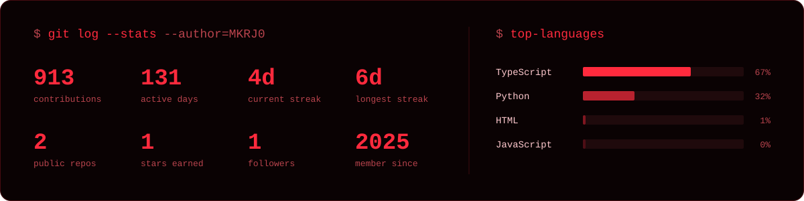

<!-- ═══════════════════════════  HERO  ═══════════════════════════ -->
<div align="center">





<a href="https://github.com/MKRJ0"></a>


<!-- TODO: uncomment and fill in once you have them
<a href="LINKEDIN_URL"></a>
<a href="PORTFOLIO_URL"></a>
<a href="mailto:YOUR_EMAIL"></a>
-->

</div>

<br>

<!-- ═══════════════════════════  ABOUT  ═══════════════════════════ -->
## 

> **I build production-ready products end to end** — from pixel-perfect, Figma-accurate React UIs
> to Dockerized Node.js backends, real booking & payment systems, and backend-controlled AI workflows.

```ts
const mkrj = {
  role:        "Full Stack Developer",
  location:    "Tehran 🇮🇷",
  frontend:    ["React", "TypeScript", "Vite", "Tailwind", "shadcn/ui"],
  backend:     ["Node.js", "Express", "Socket.io", "REST APIs", "Auth"],
  data:        ["MongoDB", "PostgreSQL", "Prisma"],
  infra:       ["Docker", "Nginx", "Linux", "CI/CD"],
  ai:          ["Flowise", "LangChain", "RAG", "Vector DBs", "Agents"],
  currently:   "Shipping COOP-BOOKING + AI-powered backend workflows",
  openTo:      ["Full Stack", "Backend (Node/TS)", "React", "AI Application"],
  motto:       "Ship it clean. Ship it fast. Ship it right.",
};
```

<br>

<!-- ═══════════════════════════  STACK  ═══════════════════════════ -->
## 

<div align="center">

| | |
| :--: | :-- |
| **Frontend** |  |
| **Backend** |  |
| **Data** |  |
| **DevOps** |  |
| **Tools** |  |

</div>

<br>

<!-- ═══════════════════════════  PROJECTS  ═══════════════════════════ -->
## 

<table>
<tr>
<td width="50%" valign="top">

### 🎫 COOP-BOOKING
**Full-stack booking & payment platform**

Reservations, seat/room booking, online payments, and a full admin panel. Built for real users and real money.

- ⚡ End-to-end booking workflow
- 💳 Payment gateway + callback handling
- 🛠️ Admin reservation management
- 🧾 QR-code receipts
- 📱 Installable PWA

     

</td>
<td width="50%" valign="top">

### 🧠 AI Assistant / RAG System
**Knowledge-base powered AI assistant**

An assistant that answers from a knowledge base and hands off to backend logic when its confidence drops, so the AI never makes unchecked decisions.

- 🔍 Vector search over the knowledge base
- 🎯 Confidence-based routing
- 🔒 Backend-controlled decision making
- 🧩 Modular AI workflow design

   

</td>
</tr>
</table>

<br>

<!-- ═══════════════════════════  STATS  ═══════════════════════════ -->
## 

<div align="center">



</div>

<br>

<!-- ═══════════════════════════  FOCUS  ═══════════════════════════ -->
## 

```yaml
learning:      [Advanced React patterns, Performance optimization, Kubernetes, AI agents & RAG]
building:      [COOP-BOOKING, AI-powered backend workflows]
interested_in: [SaaS, AI-powered apps, Cloud-native systems, Backend-heavy architecture]
open_to:       [Full Stack, Backend (Node.js/TS), React, AI Application, Junior/Mid SWE]
```

<br>

<!-- ═══════════════════════════  SNAKE  ═══════════════════════════ -->
<div align="center">

<picture>
  <source media="(prefers-color-scheme: dark)" srcset="https://raw.githubusercontent.com/MKRJ0/MKRJ0/output/github-snake-dark.svg" />
  <source media="(prefers-color-scheme: light)" srcset="https://raw.githubusercontent.com/MKRJ0/MKRJ0/output/github-snake.svg" />
  
</picture>

</div>

<!-- ═══════════════════════════  FOOTER  ═══════════════════════════ -->
<div align="center">

<br>

**`> connect`** &nbsp;·&nbsp; Let's build something that makes people say *wow*.

<a href="https://github.com/MKRJ0"></a>


</div>
